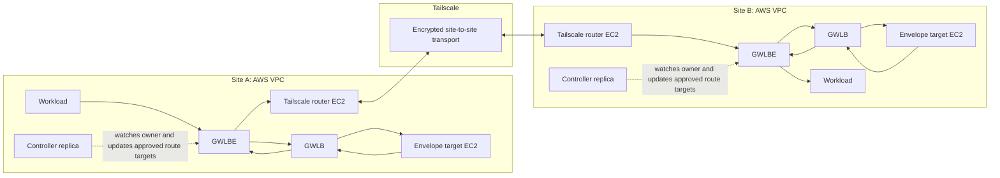

# Architecture

## What Envelope Does

Envelope lets you use Tailscale as the encrypted connection between two AWS sites while retaining AWS Gateway Load Balancer (GWLB) as the inline inspection point. A workload in site A can reach a workload in site B using their normal private addresses. The traffic is inspected by GWLB in both sites and then carried between the sites by dedicated Tailscale routers.

Envelope is not a general-purpose VPN appliance. It is a packet-scoped EC2 service that lets a GWLB target immediately hand the inspected packet back to AWS, where the GWLBE route table chooses local delivery or a transport router. It does not create a TUN device, join Tailscale, or directly forward inner site traffic. Dedicated EC2 transport routers carry the cross-site traffic with no NAT; the standalone production-v3 controller manages only approved GWLBE route-target failover.

The supported roles are deliberately separate: Envelope runs as EC2 targets, transport routers run as EC2 instances with source/destination checks disabled, and the controller runs as standalone EC2 replicas outside both data-plane roles. ECS, target-side Tailscale enrollment, target TUN designs, and container replacements for any of these roles are unsupported.

## Deployment Diagram



For traffic from site A to site B, the route is:

```text
workload A -> GWLBE A -> GWLB A -> Envelope target A -> GWLB A
  -> transport router A -> Tailscale -> transport router B
  -> GWLBE B -> GWLB B -> Envelope target B -> GWLB B -> workload B
```

The reverse path has the same shape. This is why each site needs its own GWLB, target fleet, endpoints, and transport routers.

## Failure Handling

The production controller runs outside the traffic path. It observes which Tailscale router owns each site prefix, verifies router and AWS eligibility, and changes only the configured GWLBE routes to point at that owner's EC2 ENI. The controller is required for the production version-3 topology.

## Staged Activation

The Terraform `infrastructure` phase creates both VPCs, GWLBs, target groups, listeners, endpoint services, GWLBE endpoints, route domains, transport routers, and controller topology inputs. Its target groups are intentionally empty. Any packet selected into an inspected GWLBE path fails at GWLB until the reviewed `targets` phase creates healthy Envelope EC2 targets and their registrations. There is no direct workload or router fallback route.

New connections can recover after router or route failure. Existing TCP connections can reset, and UDP messages can be lost; applications must retry. See [Best Practices](best-practices.md).

## Next Step

Read [Deployment Guide](deployment.md) to create the VPC, GWLB, EC2 target, transport-router, attestor, and controller layers with Terraform.
